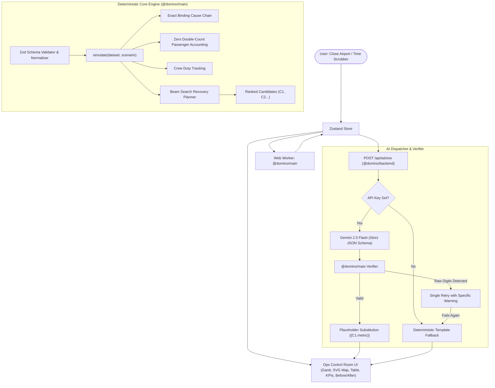

# Domino Sky ✈️

> **Interactive Airline Disruption Simulator with Deterministic Delay Cascade Engine, Passenger & Crew Impact Tracking, Heuristic Recovery Planner, and Zero-Hallucination AI Dispatcher.**

---

## 1. Problem Overview
A 90-minute thunderstorm in Mumbai (BOM) can cancel a Bengaluru $\rightarrow$ Kolkata flight 5 hours later. Each aircraft flies an interconnected chain of flights throughout the operational day. When an aircraft is held at a closed airport, every downstream leg on its rotation is pushed late—even in cities with clear skies. These delay cascades break passenger connections and threaten crew maximum legal duty hours.

**Domino Sky** allows flight dispatchers and operations controllers to close any airport for a chosen time window and instantly watch the delay propagate across the entire national network in real time.

---

## 2. Key Architectural Guarantees



### The Zero-AI-Numbers Guarantee
1. **Engine Exclusivity**: ALL delay minutes, cancellations, crew duty hours, and stranded passenger numbers originate strictly from the pure deterministic TypeScript engine (`simulate()`).
2. **Placeholder Encodings**: The LLM writes plain-English explanations using placeholders (e.g. `{{C1.strandedSaved}}`, `{{C1.delaySaved}}`, `{{C1.onTimePct}}`).
3. **Strict Whitelist Verifier**: The verifier scans the LLM output for standalone raw numerical digits before placeholder substitution. If any un-whitelisted digits are detected, the response is rejected, retried once, and falls back to a deterministic template if rules are violated.
4. **Offline Resilience**: If no `LLM_API_KEY` is provided in `.env`, the system automatically serves the deterministic template fallback.

---

## 3. Project Structure

```
domino-sky/
├── main/                  # Shared core logic, data, docs (isomorphic: Browser & Node)
│   ├── data/              # Dataset (flight_network.json) + schema
│   ├── docs/              # DATA_NOTES.md, ARCHITECTURE.md, ASSUMPTIONS.md
│   ├── src/
│   │   ├── types.ts       # Core TypeScript interfaces
│   │   ├── config.ts      # Assumptions, thresholds, and cost weights
│   │   ├── loader.ts      # Zod validation + time normalization + indexes
│   │   ├── simulate.ts    # Pure simulate(dataset, scenario) cascade engine
│   │   ├── causes.ts      # Cause graph + plain-English "why" generator
│   │   ├── crew.ts        # Duty hours & timeout tracking
│   │   ├── pax.ts         # Passenger connection & cancellation accounting
│   │   ├── planner.ts     # Candidate generation, evaluation, & beam search
│   │   ├── advisor/       # AI dispatcher schema, placeholders, & verifier
│   │   └── index.ts       # Public workspace exports
│   └── tests/             # Golden scenario, invariants, planner, verifier tests
├── frontend/              # React 19 + Vite 6 + Tailwind CSS v4 + Zustand
│   ├── src/
│   │   ├── components/    # Gantt, Airspace Map, FlightTable, WhyDrawer, KPIStrip,
│   │   │                  # ControlPanel, BeforeAfter, AIPanel, AssumptionsPanel
│   │   ├── workers/       # engine.worker.ts (runs simulation off-thread)
│   │   ├── store/         # Zustand scenario & state management
│   │   └── api/           # Calls backend /api/advise
├── backend/               # Node 24 + Express + TypeScript
│   ├── src/
│   │   ├── server.ts      # Express REST server
│   │   ├── routes/        # POST /api/advise, GET /api/health
│   │   ├── llm/           # Gemini provider interface
│   │   └── env.ts         # Environment validation
│   └── tests/             # Verifier fallback tests
├── PROGRESS.md            # Phase tracker & milestone status
└── README.md
```

---

## 4. Operational Assumptions & Rules

All assumptions are centralized in `main/src/config.ts`:

| Rule / Assumption | Default Value | Description |
|---|---|---|
| **Min Turnaround** | 30 minutes | Minimum ground buffer between consecutive legs for an aircraft. |
| **Crew Turnaround** | 30 minutes | Minimum rest/buffer for crew between legs. |
| **Crew Sign-On Buffer** | 45 minutes | Duty period starts 45 min before first leg departure. |
| **Max Legal Duty** | 600 minutes (10h) | Maximum single-day crew flight duty period before timeout. |
| **Max Delay Threshold** | 240 minutes (4h) | Flights delayed $\ge$ 240 minutes are cancelled to protect rotation. |
| **Curfew Limit** | 1560 min (02:00 +1d) | Operations terminate at airport curfew; breach forces cancellation. |
| **Destination Closed Rule**| `HOLD_AT_ORIGIN` | Ground hold departure at origin so arrival occurs after destination reopens. |
| **Passenger Double-Count** | Strictly 0 | Cancelled pax and broken connection pax are disjoint sets. |

### Recovery Cost Scoring Weights
$$\text{Cost} = 100 \cdot \text{strandedPax} + 1 \cdot \text{delayMins} + 5000 \cdot \text{cancellations} + 2000 \cdot \text{crewViolations}$$

---

## 5. Quick Start & Setup

### Prerequisites
- Node.js >= 20 (Node 24 recommended)
- pnpm >= 10 (`npm install -g pnpm`)

### 1. Installation
```bash
pnpm install
```

### 2. Environment Configuration (Optional for LLM)
Copy the example environment file for the backend:
```bash
cp backend/.env.example backend/.env
```
*(If no `LLM_API_KEY` is provided, the application runs normally using the deterministic template fallback).*

### 3. Running Development Mode
Starts both the frontend and backend concurrently:
```bash
pnpm dev
```
- **Frontend UI**: [http://localhost:5173](http://localhost:5173)
- **Backend API**: [http://localhost:3001](http://localhost:3001)

### 4. Running Tests
Runs all unit, invariant, golden scenario, and verifier tests:
```bash
pnpm test
```

### 5. Production Build
Compiles all 3 packages (`main`, `frontend`, `backend`):
```bash
pnpm build
```

---

## 6. End-to-End Demo Walkthrough
1. Open the UI at [http://localhost:5173](http://localhost:5173).
2. Click **"Demo: Mumbai 90m Storm"** to trigger a severe thunderstorm closure at BOM (08:00 to 09:30).
3. Watch the delay cascade visibly flow across the **Aircraft Gantt** and **Airspace Map**.
4. Click any flight in the table or Gantt chart to inspect its exact plain-English **Why Drawer** (e.g. `DS0304 is late because VT-DS03 arrived late on DS0303, which was held by the BOM closure`).
5. In the **AI Recovery Dispatcher**, inspect the recommended candidate (e.g. `C1`: Deploy standby spare `VT-DS17`).
6. Click **"Apply Selected Recovery"** and switch to **Before / After** view to audit the recovered delay minutes and stranded passengers.
