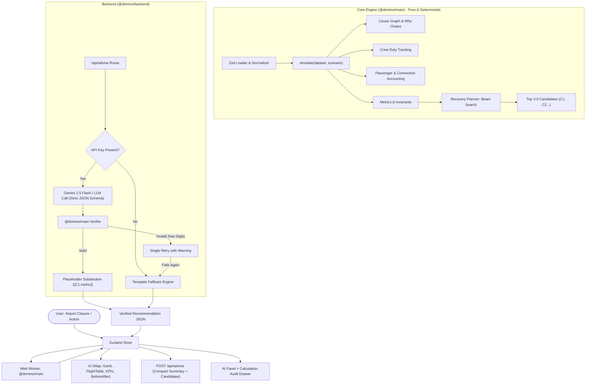

# Domino Sky — System Architecture

## Core Architectural Guarantees

1. **Zero Hallucination Numbers**:
   - The LLM never invents numbers. All metrics (`stranded`, `delayedCount`, `delayMins`, `cancelledCount`, `cost`) are produced exclusively by deterministic simulation inside `@domino/main`.
   - The LLM writes templates with placeholders (e.g. `{{C1.stranded}}`, `{{C1.totalDelay}}`).
   - The verifier validates that no raw un-whitelisted digits exist in LLM text and substitutes exact engine numbers before display.

2. **Isomorphic Pure Engine**:
   - `simulate()` has zero side-effects, no global state, no `Date.now()`, no `Math.random()`, and no network or DOM access.
   - The exact same code executes inside the browser Web Worker for instant sub-300ms UI responsiveness, inside the test suite, and inside the Node.js backend.

3. **Cause Tracing via Directed Graph**:
   - When a flight is delayed, the engine identifies the binding constraint ($readyAircraft$, $readyCrew$, or $readyAirport$).
   - A backward link to the parent flight creates an unambiguous domino cause chain: e.g. `AI-204 BLR->CCU is 140 min late because VT-X arrived late from BOM, which was held by the BOM closure.`
